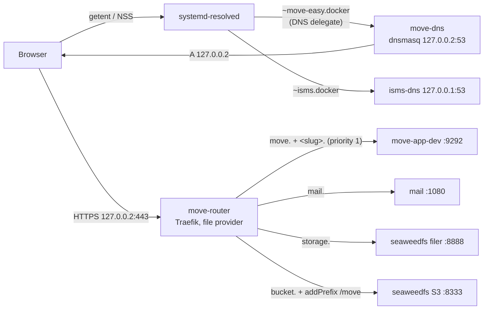
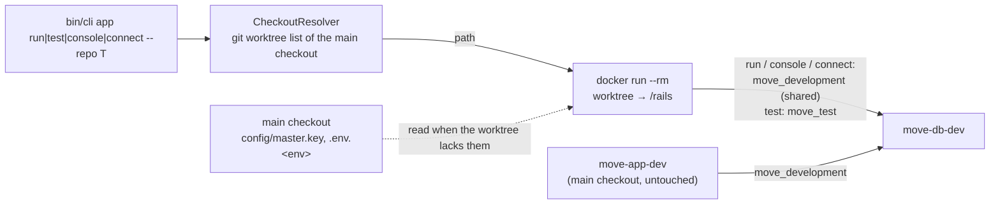
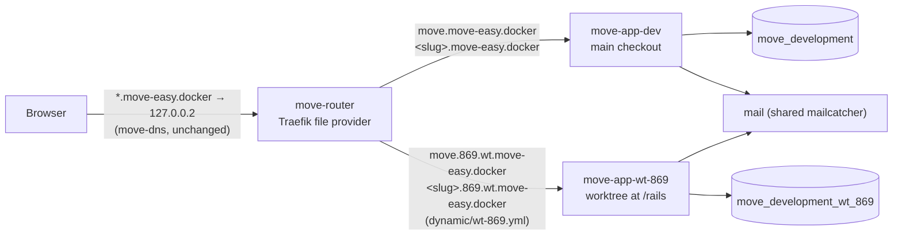

# Local HTTPS edge (move-dns + move-router)

Move owns its local edge: its own DNS server and its own HTTPS router, both on
the loopback IP **127.0.0.2**. This is the ISMS CLI V2 approach (#828). It
replaces the old shared Traefik (Docker-label provider) and the whole-`.docker`
DNS, which no longer exist on this machine.

Since everything lives on 127.0.0.2, Move runs next to the ISMS V2 stack (which
owns `127.0.0.1:53/443`) on standard ports, with no conflict.


The editable scene is [`diagrams/local-edge.excalidraw`](diagrams/local-edge.excalidraw).

## Request flow



| Piece | What it does | Where |
|---|---|---|
| `move-dns` | dnsmasq answering every name under `move-easy.docker` with 127.0.0.2. No upstreams: anything outside the zone is refused, so it is never an open resolver. | `config/dns/`, `bin/cli-files/dns-cmd/` |
| Host DNS delegate | `/etc/systemd/dns-delegate.d/move-easy-docker.dns-delegate` routes only `~move-easy.docker` to move-dns (systemd 258+). The one root-only step. | `bin/cli dns bootstrap` prints it |
| `move-router` | Traefik with the **file provider only**: no Docker socket, no container labels. Config is rendered to `~/.local/state/move/router/` on every `start`, and `watch: true` applies edits live. | `bin/cli-files/router-cmd/` |
| Certificates | A per-developer root CA, **name-constrained** to `move-easy.docker`, plus an 825-day leaf for the apex and `*.move-easy.docker`. Generated with Ruby OpenSSL. The CA key never enters a container (only `certs/leaf/` is mounted). | `~/.local/state/move/certs/` |
| Trust | `bin/cli router trust` adds the CA to the per-user NSS store (`~/.pki/nssdb`, read by Chrome/Chromium/Brave). No sudo. | |

Routes live in one place, `RouterConfig#routers`. The tenant catch-all's
`priority: 1` is load-bearing: Traefik's default priority is the rule length,
and the `HostRegexp` is longer than every `Host()` rule, so without it the
catch-all would swallow `mail.`, `storage.` and `bucket.`.

## First-time setup

```bash
bin/cli services start      # dns + router first, then db, storage, app
bin/cli dns bootstrap       # prints the root-only delegate step; run it once
bin/cli router trust        # trust the dev CA for this user; restart the browser
bin/cli dns check           # container + delegate + resolution via getent
bin/cli router check        # container + certs + a live TLS handshake + trust
```

`bin/cli router certs --rotate` replaces the root CA (re-run `trust`, then
`router restart`). `router start` renews only the leaf when it nears expiry,
so the trusted CA stays put.

Overrides: `MOVE_EDGE_IP` (default `127.0.0.2`; keep `config/dns/dnsmasq.conf`
in sync), `MOVE_TRAEFIK_VERSION`, `MOVE_APP_UPSTREAM`.

## Worktrees

`bin/cli app start` serves **one** checkout in the single `move-app-dev`
container. To live-check or test another git worktree without replacing it, use
the throwaway commands. Each starts a one-off app container on the Docker
network with the chosen checkout mounted at `/rails`, and leaves `move-app-dev`
alone.

```bash
bin/cli app run     --repo fix/862-cli -- bin/rails runner 'puts Item.count'
bin/cli app console --repo fix/862-cli        # Rails console in a throwaway container
bin/cli app connect --repo fix/862-cli        # bash in a throwaway container
bin/cli app test    --repo fix/862-cli -- spec/actions/items
bin/cli app test    --repo ../move-wt-foo     # whole unit suite (no system specs)
bin/cli app test    --repo ../move-wt-foo --system   # spec/system under rack_test
```



**`--repo <target>`** (default: the main checkout, i.e. the first
`git worktree list` entry, even when `bin/cli` is run from a worktree):

- starts with `/`, `.` or `~`: a path to a checkout (must have a `Gemfile`);
- anything else: a worktree **name**, matched on branch first (slashes
  included), then on directory name. The current directory is never used
  implicitly.
- An unknown name fails before any container starts and lists the worktrees;
  an ambiguous one names the matching paths; a registered but missing
  worktree suggests `git worktree prune`.

**Shared dev database.** `app run`, `app console` and `app connect` use the
same `move_development` database as `move-app-dev`, so console writes and
migrations from a worktree change the data **and schema** main's dev app runs
on (and what its `db/structure.sql` dump contains). Their banner says so:
`Database: move_development (shared with move-app-dev)`. `app test` uses
`move_test` instead (see below). A per-worktree database is the open design
question in the proposal below (#869 part 3).

**`app run [ENV] [--repo T] [--yes] -- CMD...`** prints `Running in <path> (branch <b>)`
and the database line first, brings up the database, and exits with the
command's status. From a worktree (any checkout but the main one), a command
that runs a Rails db task that changes the schema or wipes data prints a
warning and is refused unless `--yes` is given, before any container starts.
The gated tasks are `db:migrate` and its subtasks except `db:migrate:status`,
plus `db:rollback`, `db:forward`, `db:schema:load`, `db:structure:load`,
`db:reset`, `db:prepare`, `db:setup`, `db:drop`, `db:purge`,
`db:truncate_all`, `db:seed:replant` and `db:fixtures:load`. The check matches
the task name anywhere in the command (so `bash -c "bin/rails db:migrate"` is
caught); a mere mention such as `echo db:migrate` asks for `--yes` too. stdin is
attached only when it is a TTY (`--tty` only when stdout is one too), so it
works in pipes and agent shells. It is **dev-only**: `app run prod …` is
refused, because the prod image runs its baked-in build rather than a mounted
checkout (use `bin/cli app exec prod …` for that image).

**`app console [ENV] [--repo T]` / `app connect [ENV] [--repo T]`.** Without
`--repo` they attach to the long-lived container as before
(`docker exec -it move-app-dev bin/rails console` / `bash`, prod included).
With `--repo` they open `bin/rails console` / `bash` in a throwaway container
for that checkout, the same way `app run` does: banner first, database up,
exit with the session's status, dev only (same refusal message). stdin is
always attached, so a script can be piped in
(`echo 'puts User.count' | bin/cli app console --repo T`); `--tty` is added
only when stdin and stdout are both terminals.

**`app test [--repo T] [-- RSPEC_ARGS...]`** runs
`bin/rails db:test:prepare && bundle exec rspec …` under `RAILS_ENV=test` in a
container named `move-app-test`, and exits with rspec's status. With no
arguments it runs the unit suite (`spec --exclude-pattern "spec/system/**/*_spec.rb"`).
All worktrees share the one `move_test` database, so runs are serialised:

- an `flock` on `<main>/tmp/bin-cli-app-test.lock` names its holder (pid,
  checkout, branch, start time); an overlapping run is refused with that
  holder. The kernel drops the lock when the holder dies.
- the fixed container name catches a leftover run:
  `docker rm -f move-app-test`.
- a plain `bundle exec rspec` inside `move-app-dev` does **not** take the lock.

**`app test --system`** runs `spec/system` with `TEST_BROWSER=rack_test`, as
CI does, under the same lock and container. Arguments after `--` are passed
through; `spec/system` is prepended unless one of them already names a
`spec/system…` path. `:js` specs switch to headless Chrome, which needs
chromedriver. The dev image has none, so when `command -v chromedriver` fails
in the image they are excluded (`--tag ~js`) with a one-line note that they
run in CI only. When you name `spec/system…` paths yourself, the run also sets
RSpec's `fail_if_no_examples` (there is no CLI flag for it, so a one-line file
written to the container's `/tmp` is passed with `--require`). Naming only
`:js` specs then fails (exit 1) instead of passing with `0 examples`.

**Gitignored files.** A fresh worktree has no `config/master.key` or
`.env.<env>`. They are read from the worktree when present, otherwise from the
main checkout, and are never copied into the worktree (`git status` stays
clean). A directory where one of them should be (Docker creates a missing bind
source as an empty directory) is refused with an `rmdir` hint. `tmp/` and
`log/` are pre-created as the host user.

**Gemfile.lock drift.** The container runs the gems baked into
`workeverywhere/move-app:latest`. When the worktree's `Gemfile.lock` differs
from the image's, a warning is printed. If gems changed, build a private image
from the worktree (`DOCKER_NAMESPACE=wt<n> bin/cli app build`) and run with the
same `DOCKER_NAMESPACE`, so the shared `workeverywhere/move-app:latest`, which
must keep matching main, is left alone.

**`app start` / `restart` / `rebuild` from a worktree** serve that worktree in
`move-app-dev` (the one dev container, so one checkout at a time). They read
`config/master.key` and `.env.<env>` with the same fallback (worktree first,
then the main checkout, never copied). `restart` and `rebuild` run every check
that can fail (master key, image present or built, Ruby version, `bundle check`
of the checkout's `Gemfile.lock` against the image's gems, router, db, storage)
**before** stopping the running container, so a failed restart leaves the
current app up. A lock the image doesn't satisfy is refused with a
`bin/cli app build` hint. Put main back with `bin/cli app restart` from the main
checkout.

**Not covered yet:** serving a worktree **in the browser** next to main. See
the proposal below (#869 part 3).

### Proposed: serving a worktree in the browser

> **Status: proposal, pending user sign-off. Nothing here is implemented.**
> Each question lists the recommended option first. Implementation (#869
> step B) touches auth and tenancy, so it needs a `/security-review` and the
> full live auth journey (AGENTS.md rule 3).

Today a browser live check means `bin/cli app restart` from the worktree,
which replaces `move-app-dev` (one agent at a time), then restoring main. The
goal is a second, routed app per worktree that runs next to main.



**1. Hostname scheme.** The elevator (`MoveTenantElevator`) takes the single
label left of `config.x.tenant_zone`; a host with more labels stays on the
public schema. Every tenant and apex URL derives from `tenant_zone` and the
mailer `default_url_options[:host]` (handoff, `RodauthMailer`, invitations,
CSP).

- **Recommended:** a per-worktree zone `<wt>.wt.move-easy.docker`. The apex is
  `move.<wt>.wt.move-easy.docker` and orgs are `<slug>.<wt>.wt.move-easy.docker`.
  `<wt>` is a sanitised `[a-z0-9-]{1,20}` label from the worktree directory
  name, or `--name`. The worktree container sets the zone and apex through two
  new env overrides in `development.rb` (`MOVE_TENANT_ZONE`,
  `MOVE_APEX_HOST`), with today's values as defaults. Add `wt` to
  `EXCLUDED_SUBDOMAINS` so `wt.move-easy.docker` can never resolve as an org,
  and no org slug can collide with a worktree (the worktree label sits one
  level deeper). Main's elevator and its tenant `HostRegexp` both match one
  label only, so main never serves a worktree host.
- Rejected: a distinct parent domain per worktree (`move-wt-869.docker`). It
  needs a new root-only DNS delegate and a new CA, re-trusted, per worktree.
- Rejected: a reserved label prefix (`wt-869-<slug>.move-easy.docker`). It
  needs elevator parsing changes, and an org slug starting with `wt-` would
  collide.

**2. Router, DNS, CA.**

- **DNS:** no change. dnsmasq's `address=/move-easy.docker/127.0.0.2` answers
  every depth.
- **Router (recommended):** `app serve` writes one file per worktree,
  `~/.local/state/move/router/dynamic/wt-<wt>.yml`, with a `Host(move.<wt>…)`
  router and a `HostRegexp(^[a-z0-9-]+\.<wt>\.wt\.move-easy\.docker$)` router
  to `http://move-app-wt-<wt>:9292`. `watch: true` applies it live and `stop`
  deletes it. `RouterConfig` keeps owning main's file.
- **Certificates:** the root CA is name-constrained to `move-easy.docker`
  *and* `.move-easy.docker`, so it may sign deeper names and needs no
  re-trust. The current leaf only covers `*.move-easy.docker` (one label), so
  it does **not** cover `<slug>.<wt>.wt…`. **Recommended:** a per-worktree leaf
  for `*.<wt>.wt.move-easy.docker`, signed by the same CA and listed in that
  worktree's router file under `tls.certificates`. Traefik picks it by SNI.

**3. Auth.**

- **Cookies:** host-only (#280), so every worktree host holds its own
  `_move_session_v2`, and a main session never reaches a worktree host. No
  change.
- **Handoff token:** `SessionHandoffToken` is a public-schema row, redeemed on
  the org host it was minted for. With a per-worktree database (point 5) a
  main token can't be redeemed by a worktree app, and the reverse holds too.
  On a shared database it could be, if the user moved a URL across hosts. That
  is one more reason to recommend separate databases.
- **`WEBAUTHN_RP_ID`:** **Recommended:** leave it unset for worktree apps. It
  then derives from the request host, so passkeys are per worktree host. A
  passkey enrolled on main does not work there; email-link login does. Setting
  it to main's apex would be refused by browsers, because the RP ID must be a
  suffix of the page's host.
- **Email-link host:** Rodauth and `RodauthMailer` links follow `MOVE_APEX_HOST`
  and `MOVE_TENANT_ZONE`, so mail sent by a worktree app links back to that
  worktree. The mailcatcher is shared (one inbox): the link host tells you
  which app sent it.
- **Google sign-in:** OAuth callbacks are registered for main's hosts only, so
  it stays unavailable on worktree hosts. Accepted, not planned.

**4. ActionCable.** `allowed_request_origins` already accepts
`([a-z0-9-]+\.)*move-easy\.docker`, which covers the nested hosts. No change.
Dev uses the `async` adapter, which is per process, so each app only
broadcasts to its own clients.

**5. Data.**

- **Recommended:** a per-worktree database, `move_development_wt_<wt>`, chosen
  through a new `MOVE_DEV_DATABASE` override in `config/database.yml`.
  `app serve` runs `bin/rails db:prepare` (load the worktree's
  `structure.sql`, migrate, seed). The worktree's unapplied migrations then
  only ever touch its own database, so the main database and main's
  `structure.sql` can't drift. That was the cross-branch contamination
  failure; see the `structure-sql-cross-branch-contamination` memory. Apartment
  tenants are schemas inside that database, so they are isolated too.
- Rejected: the shared `move_development`. A worktree with a new migration
  either fails every page (`migration_error = :page_load`), or migrates main's
  database ahead of main's code and contaminates main's next schema dump.
- Rejected: a schema prefix. Apartment already uses schemas for tenants, and
  the public-schema auth tables would still be shared.

**6. Lifecycle.**

- `bin/cli app serve [--repo T] [--name W]` starts a detached
  `move-app-wt-<wt>` (same image and mount flags as `app run`, no published
  port), writes the router file and the leaf, prepares the database, waits
  for `/up` and prints the apex URL.
- `bin/cli app stop --repo T [--drop-db]` removes the container and the
  router file, and drops the database only when asked.
- A cap of **3** concurrent worktree apps (counted by container name), with
  the running ones listed on refusal.
- `bin/cli app serve --prune` stops apps whose worktree is no longer in
  `git worktree list`.
- The same Gemfile.lock drift rule as `app run` applies: the worktree runs the
  image's gems.

## Gotchas

| Symptom | Cause | Fix |
|---|---|---|
| `platform.isms.docker` resolves to 127.0.0.2 | the delegate says `Domains=move-easy.docker` without `~`, so resolved also uses the zone as a **search suffix**: a failed lookup is retried as `platform.isms.docker.move-easy.docker` | `Domains=~move-easy.docker` (routing-only). Re-run `bin/cli dns bootstrap` |
| move-dns and isms-dns get mixed up | a `resolved.conf.d` drop-in was used: drop-ins merge into **one global** server list | use a DNS **delegate**, which is scoped to its zone |
| `docker stop move-dns` hangs | dnsmasq started with `--no-daemon` serves TCP in the main process; resolved's kept-open TCP fallback stalls SIGTERM | the image uses `--keep-in-foreground` |
| `https://mail.move-easy.docker` returns 502 just after `mail start` | mailcatcher not listening yet | retry after a second |
| `bin/cli app run --repo …` fails with `Could not find <gem>-x.y.z in locally installed gems` | the worktree's `Gemfile.lock` is ahead of the image's bundle (the drift warning says so) | a private image for that shell, `DOCKER_NAMESPACE=wt<n> bin/cli app build`, then the same `DOCKER_NAMESPACE` on `app run`/`test`/`console`/`connect` (leaves the shared image, and so main, alone); or `bin/cli app build` once main has the same lock |
| `bin/cli app run --repo … -- bin/rails db:migrate` is refused with `without --yes` | the worktree shares `move_development` with `move-app-dev`, so its migrations would change main's schema | run it on purpose with `--yes` (and roll back before you leave), or test migrations with `bin/cli app test --repo …`, which uses `move_test` |
| `bin/cli app test --system -- spec/system/x_js_spec.rb` exits 1 with `0 examples` | the dev image has no chromedriver, so `:js` specs are filtered out (`--tag ~js`), and named specs run with RSpec's `fail_if_no_examples` | `:js` specs run in CI only; rely on the CI `test` job, or live-check the surface in a browser |
| `dig` works but the browser doesn't | `dig`/`nslookup` bypass NSS | check with `getent ahostsv4 <name>` (what `dns check` uses) |
| `systemctl` warns that the unit "changed on disk" during bootstrap | resolved's unit config changed | `sudo systemctl daemon-reload` before the restart |
