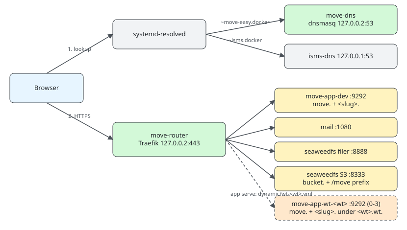
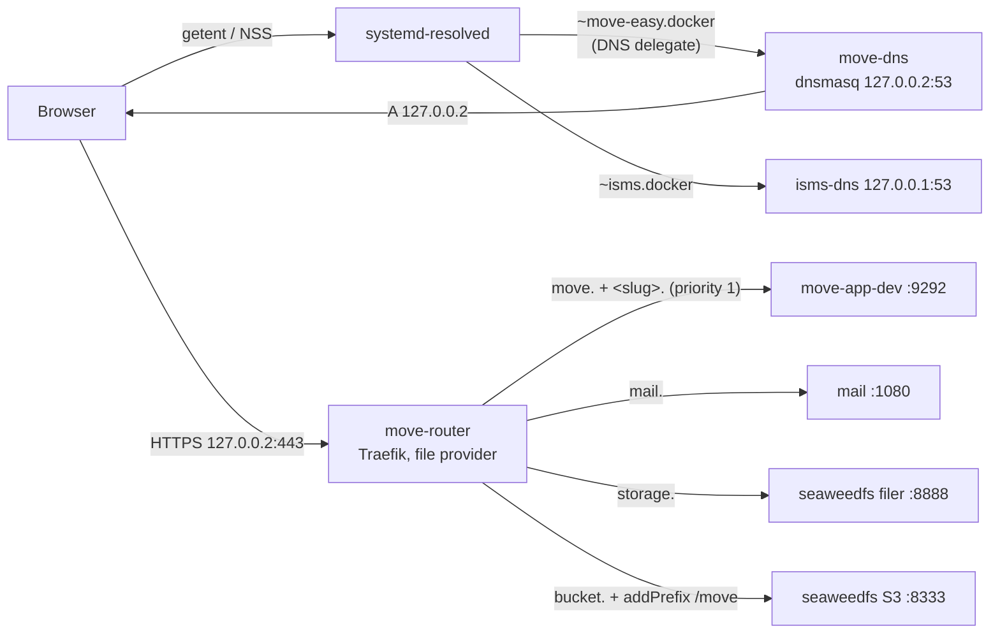

# Local HTTPS edge (move-dns + move-router)

Move owns its local edge: its own DNS server and its own HTTPS router, both on
the loopback IP **127.0.0.2**. This is the ISMS CLI V2 approach (#828). It
replaces the old shared Traefik (Docker-label provider) and the whole-`.docker`
DNS, which no longer exist on this machine.

Since everything lives on 127.0.0.2, Move runs next to the ISMS V2 stack (which
owns `127.0.0.1:53/443`) on standard ports, with no conflict.



The editable scene is [`diagrams/local-edge.excalidraw`](diagrams/local-edge.excalidraw).

## Request flow



| Piece | What it does | Where |
|---|---|---|
| `move-dns` | dnsmasq answering every name under `move-easy.docker` with 127.0.0.2. No upstreams: anything outside the zone is refused, so it is never an open resolver. | `config/dns/`, `bin/cli-files/dns-cmd/` |
| Host DNS delegate | `/etc/systemd/dns-delegate.d/move-easy-docker.dns-delegate` routes only `~move-easy.docker` to move-dns (systemd 258+). The one root-only step. | `bin/cli dns bootstrap` prints it |
| `move-router` | Traefik with the **file provider only**: no Docker socket, no container labels. Config is rendered to `~/.local/state/move/router/` on every `start`, and `watch: true` applies edits live. | `bin/cli-files/router-cmd/` |
| Certificates | A per-developer root CA, **name-constrained** to `move-easy.docker`, plus an 825-day leaf for the apex and `*.move-easy.docker`. Generated with Ruby OpenSSL. The CA key never enters a container (only `certs/leaf/` is mounted). | `~/.local/state/move/certs/` |
| Trust | `bin/cli router trust` adds the CA to the per-user NSS store (`~/.pki/nssdb`, read by Chrome/Chromium/Brave). No sudo. | |

Routes live in one place, `RouterConfig#routers`. The tenant catch-all's
`priority: 1` is load-bearing: Traefik's default priority is the rule length,
and the `HostRegexp` is longer than every `Host()` rule, so without it the
catch-all would swallow `mail.`, `storage.` and `bucket.`.

## First-time setup

```bash
bin/cli services start      # dns + router first, then db, storage, app
bin/cli dns bootstrap       # prints the root-only delegate step; run it once
bin/cli router trust        # trust the dev CA for this user; restart the browser
bin/cli dns check           # container + delegate + resolution via getent
bin/cli router check        # container + certs + a live TLS handshake + trust
```

`bin/cli router certs --rotate` replaces the root CA (re-run `trust`, then
`router restart`). `router start` renews only the leaf when it nears expiry,
so the trusted CA stays put.

Overrides: `MOVE_EDGE_IP` (default `127.0.0.2`; keep `config/dns/dnsmasq.conf`
in sync), `MOVE_TRAEFIK_VERSION`, `MOVE_APP_UPSTREAM`.

## Gotchas

| Symptom | Cause | Fix |
|---|---|---|
| `platform.isms.docker` resolves to 127.0.0.2 | the delegate says `Domains=move-easy.docker` without `~`, so resolved also uses the zone as a **search suffix**: a failed lookup is retried as `platform.isms.docker.move-easy.docker` | `Domains=~move-easy.docker` (routing-only). Re-run `bin/cli dns bootstrap` |
| move-dns and isms-dns get mixed up | a `resolved.conf.d` drop-in was used: drop-ins merge into **one global** server list | use a DNS **delegate**, which is scoped to its zone |
| `docker stop move-dns` hangs | dnsmasq started with `--no-daemon` serves TCP in the main process; resolved's kept-open TCP fallback stalls SIGTERM | the image uses `--keep-in-foreground` |
| `https://mail.move-easy.docker` returns 502 just after `mail start` | mailcatcher not listening yet | retry after a second |
| `dig` works but the browser doesn't | `dig`/`nslookup` bypass NSS | check with `getent ahostsv4 <name>` (what `dns check` uses) |
| `systemctl` warns that the unit "changed on disk" during bootstrap | resolved's unit config changed | `sudo systemctl daemon-reload` before the restart |
