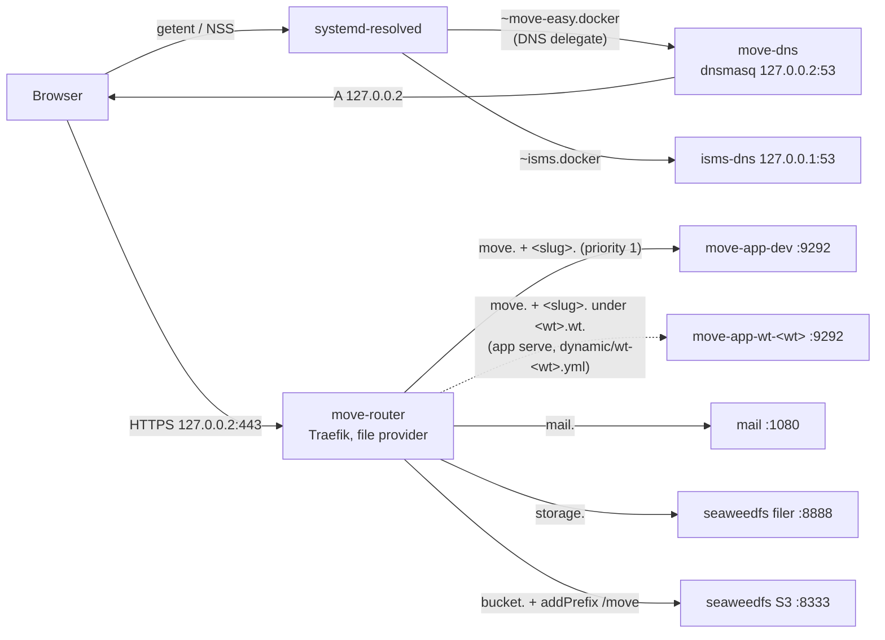
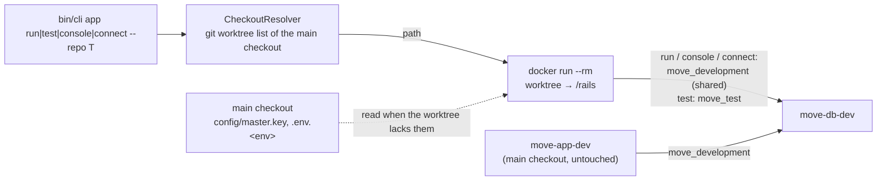
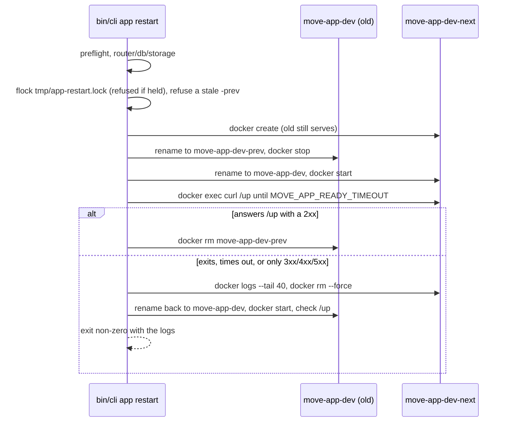
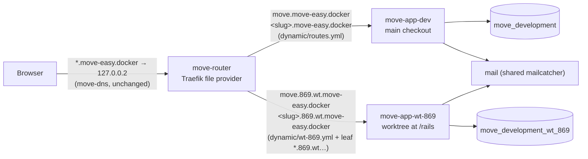

# Local HTTPS edge (move-dns + move-router)

Move owns its local edge: its own DNS server and its own HTTPS router, both on
the loopback IP **127.0.0.2**. This is the ISMS CLI V2 approach (#828). It
replaces the old shared Traefik (Docker-label provider) and the whole-`.docker`
DNS, which no longer exist on this machine.

Since everything lives on 127.0.0.2, Move runs next to the ISMS V2 stack (which
owns `127.0.0.1:53/443`) on standard ports, with no conflict.


The editable scene is [`diagrams/local-edge.excalidraw`](diagrams/local-edge.excalidraw).

## Request flow



| Piece | What it does | Where |
|---|---|---|
| `move-dns` | dnsmasq answering every name under `move-easy.docker` with 127.0.0.2. No upstreams: anything outside the zone is refused, so it is never an open resolver. | `config/dns/`, `bin/cli-files/dns-cmd/` |
| Host DNS delegate | `/etc/systemd/dns-delegate.d/move-easy-docker.dns-delegate` routes only `~move-easy.docker` to move-dns (systemd 258+). The one root-only step. | `bin/cli dns bootstrap` prints it |
| `move-router` | Traefik with the **file provider only**: no Docker socket, no container labels. Config is rendered to `~/.local/state/move/router/` on every `start`, and `watch: true` applies edits live. | `bin/cli-files/router-cmd/` |
| Certificates | A per-developer root CA, **name-constrained** to `move-easy.docker`, plus an 825-day leaf for the apex and `*.move-easy.docker`, and one `*.<wt>.wt.move-easy.docker` leaf per served worktree (`app serve`). Generated with Ruby OpenSSL. The CA key never enters a container (only `certs/leaf/` is mounted). | `~/.local/state/move/certs/` |
| Trust | `bin/cli router trust` adds the CA to the per-user NSS store (`~/.pki/nssdb`, read by Chrome/Chromium/Brave). No sudo. | |

Routes live in one place, `RouterConfig#routers`. The tenant catch-all's
`priority: 1` is load-bearing: Traefik's default priority is the rule length,
and the `HostRegexp` is longer than every `Host()` rule, so without it the
catch-all would swallow `mail.`, `storage.` and `bucket.`.

## First-time setup

```bash
bin/cli services start      # dns + router first, then db, storage, app
bin/cli dns bootstrap       # prints the root-only delegate step; run it once
bin/cli router trust        # trust the dev CA for this user; restart the browser
bin/cli dns check           # container + delegate + resolution via getent
bin/cli router check        # container + certs + a live TLS handshake + trust
```

`bin/cli router certs --rotate` replaces the root CA (re-run `trust`, then
`router restart`). `router start` renews only the leaf when it nears expiry,
so the trusted CA stays put.

Overrides: `MOVE_EDGE_IP` (default `127.0.0.2`; keep `config/dns/dnsmasq.conf`
in sync), `MOVE_TRAEFIK_VERSION`, `MOVE_APP_UPSTREAM`.

## Worktrees

`bin/cli app start` serves **one** checkout in the single `move-app-dev`
container. To live-check or test another git worktree without replacing it, use
the throwaway commands. Each starts a one-off app container on the Docker
network with the chosen checkout mounted at `/rails`, and leaves `move-app-dev`
alone.

```bash
bin/cli app run     --repo fix/862-cli -- bin/rails runner 'puts Item.count'
bin/cli app console --repo fix/862-cli        # Rails console in a throwaway container
bin/cli app connect --repo fix/862-cli        # bash in a throwaway container
bin/cli app test    --repo fix/862-cli -- spec/actions/items
bin/cli app test    --repo ../move-wt-foo     # whole unit suite (no system specs)
bin/cli app test    --repo ../move-wt-foo --system   # spec/system under rack_test
```



**`--repo <target>`** (default: the main checkout, i.e. the first
`git worktree list` entry, even when `bin/cli` is run from a worktree):

- starts with `/`, `.` or `~`: a path to a checkout (must have a `Gemfile`);
- anything else: a worktree **name**, matched on branch first (slashes
  included), then on directory name. The current directory is never used
  implicitly.
- An unknown name fails before any container starts and lists the worktrees;
  an ambiguous one names the matching paths; a registered but missing
  worktree suggests `git worktree prune`.

**Shared dev database.** `app run`, `app console` and `app connect` use the
same `move_development` database as `move-app-dev`, so console writes and
migrations from a worktree change the data **and schema** main's dev app runs
on (and what its `db/structure.sql` dump contains). Their banner says so:
`Database: move_development (shared with move-app-dev)`. `app test` uses
`move_test` instead (see below). `app serve` gives a worktree its own
database (see [Serving a worktree in the browser](#serving-a-worktree-in-the-browser-app-serve)).

**`app run [ENV] [--repo T] [--yes] -- CMD...`** prints `Running in <path> (branch <b>)`
and the database line first, brings up the database, and exits with the
command's status. From a worktree (any checkout but the main one), a command
that runs a Rails db task that changes the schema or wipes data prints a
warning and is refused unless `--yes` is given, before any container starts.
The gated tasks are `db:migrate` and its subtasks except `db:migrate:status`,
plus `db:rollback`, `db:forward`, `db:schema:load`, `db:structure:load`,
`db:reset`, `db:prepare`, `db:setup`, `db:drop`, `db:purge`,
`db:truncate_all`, `db:seed:replant` and `db:fixtures:load`, each with any
namespaced variant (`db:reset:all`, `db:purge:all`, `db:migrate:primary`, …;
`db:migrate:status` in any form stays ungated). Only a task given
to `rails`/`rake` counts, including `bin/rails`, `bundle exec rake` and inside
`bash -c "…"` (each argument is shell-split, and `&&`/`;`/`|` start a new
command, as do the grouping and substitution marks `( … )`, `{ …; }`,
`$( … )` and backticks, so `bash -c '(bin/rails db:migrate)'` is gated); a mere mention such as `echo db:migrate` or `rg db:migrate doc` runs
without `--yes`. Several tasks in one call (`rake db:seed db:migrate`) are all
checked. Once `rails`/`rake` gets a command whose arguments are free-form
(`runner`/`r`, `console`/`c`, `generate`/`g`, `destroy`/`d`, `server`/`s`,
`dbconsole`/`db`, `credentials:*`, `encrypted:*`), the rest of that command is
not scanned, so `bin/rails runner 'puts "db:migrate"'` and
`bin/rails generate migration db:reset` run without `--yes`; a later
`&& bin/rails db:migrate` is still gated. stdin is
attached only when it is a TTY (`--tty` only when stdout is one too), so it
works in pipes and agent shells. It is **dev-only**: `app run prod …` is
refused, because the prod image runs its baked-in build rather than a mounted
checkout (use `bin/cli app exec prod …` for that image).

**`app console [ENV] [--repo T]` / `app connect [ENV] [--repo T]`.** Without
`--repo` they attach to the long-lived container as before
(`docker exec -it move-app-dev bin/rails console` / `bash`, prod included).
With `--repo` they open `bin/rails console` / `bash` in a throwaway container
for that checkout, the same way `app run` does: banner first, database up,
exit with the session's status, dev only (same refusal message). stdin is
always attached, so a script can be piped in
(`echo 'puts User.count' | bin/cli app console --repo T`); `--tty` is added
only when stdin and stdout are both terminals.

**`app test [--repo T] [-- RSPEC_ARGS...]`** runs
`bin/rails db:test:prepare && bundle exec rspec …` under `RAILS_ENV=test` in a
container named `move-app-test`, and exits with rspec's status. With no
arguments it runs the unit suite (`spec --exclude-pattern "spec/system/**/*_spec.rb"`).
All worktrees share the one `move_test` database, so runs are serialised:

- an `flock` on `<main>/tmp/bin-cli-app-test.lock` names its holder (pid,
  checkout, branch, start time); an overlapping run is refused with that
  holder. The kernel drops the lock when the holder dies.
- the fixed container name catches a leftover run:
  `docker rm -f move-app-test`.
- a plain `bundle exec rspec` inside `move-app-dev` does **not** take the lock.

**`app test --system`** runs `spec/system` with `TEST_BROWSER=rack_test`, as
CI does, under the same lock and container. Arguments after `--` are passed
through; `spec/system` is prepended unless one of them already names a
`spec/system…` path. `:js` specs switch to headless Chrome, which needs
chromedriver. The dev image has none, so when `command -v chromedriver` fails
in the image they are excluded (`--tag ~js`) with a one-line note that they
run in CI only. When you name `spec/system…` paths yourself, the run also sets
RSpec's `fail_if_no_examples` (there is no CLI flag for it, so a one-line file
written to the container's `/tmp` is passed with `--require`). Naming only
`:js` specs then fails (exit 1) instead of passing with `0 examples`.

**Gitignored files.** A fresh worktree has no `config/master.key` or
`.env.<env>`. They are read from the worktree when present, otherwise from the
main checkout, and are never copied into the worktree (`git status` stays
clean). A directory where one of them should be (Docker creates a missing bind
source as an empty directory) is refused with an `rmdir` hint. `tmp/` and
`log/` are pre-created as the host user.

**Gemfile.lock drift.** The container runs the gems baked into
`workeverywhere/move-app:latest`. When the worktree's `Gemfile.lock` differs
from the image's, a warning is printed. If gems changed, build a private image
from the worktree (`DOCKER_NAMESPACE=wt<n> bin/cli app build`) and run with the
same `DOCKER_NAMESPACE`, so the shared `workeverywhere/move-app:latest`, which
must keep matching main, is left alone.

**`app start` / `restart` / `rebuild` from a worktree** serve that worktree in
`move-app-dev` (the one dev container, so one checkout at a time). They read
`config/master.key` and `.env.<env>` with the same fallback (worktree first,
then the main checkout, never copied). Every input of the app container is
checked in one preflight (`AppService#preflight` → `AppPreflight`): the
network, `config/master.key` and `.env.<env>` (present, a file, readable, key
not blank), the host side of every volume, the image (built if missing) and
its Ruby, and a `bundle check` of the checkout's `Gemfile.lock` against the
image's gems. `restart` and `rebuild` run it, then start router/db/storage,
**before** stopping the running container, so a failed restart leaves the
current app up. A lock the image doesn't satisfy is refused with a
`bin/cli app build` hint. The replacement is then `docker create`d as
`move-app-dev-next` while the old app still serves, so Docker has accepted its
flags, `--env-file`, image and network before anything stops.

The swap is a **rollback, not blue/green**: a candidate booted next to the
live app would migrate the shared `move_development` under it. The old
container is renamed `move-app-dev-prev` and stopped (not removed); the new
one is renamed to `move-app-dev`, started, and must answer `GET /up` with a
**2xx** (a `curl --write-out '%{http_code}'` run with `docker exec` inside
it; a 3xx redirect is not ready) within `MOVE_APP_READY_TIMEOUT` seconds
(default 60; the wait ends early when the container exits).

- **Ready:** `move-app-dev-prev` is removed.
- **Not ready** (a wrong master key, an exception while Rails boots, a slow
  boot past the timeout): the replacement is removed, `move-app-dev-prev` is
  renamed back, its checkout's stale `tmp/pids/server.pid` is removed, and it
  is started and checked again. The command then **exits non-zero** with the
  replacement's last 40 log lines and says whether the old app is back.
- **A stale `move-app-dev-prev`** (a restart killed mid-swap) makes `start`
  and `restart` stop before touching anything, with the fix for the state it
  finds: `docker rm --force move-app-dev-prev` when `move-app-dev` runs, or
  the `docker rename … && docker start …` that brings it back when it does not.
- **One at a time, host-wide.** `start`, `stop` and the swap of `restart` /
  `rebuild` hold an `flock` on `<main>/tmp/app-restart.lock` (separate from
  the `app test` lock), because they reuse the fixed `move-app-dev`,
  `-next` and `-prev` names. The holder writes its pid, checkout, branch and
  start time there; a second caller from any checkout is refused before any
  docker call with `Refused: another restart is in progress (<holder>)`. The
  kernel drops the lock when the holder dies. The preflight and
  router/db/storage start of a restart run before the lock is taken.

`app start` uses the same readiness check: when the new container does not
answer, it is removed and the command exits non-zero with its logs. App
containers no longer run with `--rm` (the logs of a failed boot would vanish
with it), so `app stop` removes the container after stopping it. A container
started with `--rm` by an older `bin/cli` can't be kept, so its first restart
has no rollback. The reverse also holds: an older `bin/cli` (a main checkout not yet
pulled past #879) only `docker stop`s before its `docker run --name`, so it
can't replace a container started by this one. Run `docker rm move-app-dev`
after that stop, or pull main first. Put main back with `bin/cli app restart` from the main
checkout.



To browser-check a worktree **without** replacing `move-app-dev`, serve it
next to main with `bin/cli app serve` (below).

### Serving a worktree in the browser (`app serve`)

```bash
bin/cli app serve --repo feature/869-x          # https://move.<wt>.wt.move-easy.docker
bin/cli app serve --repo ../move-wt-foo --name foo
bin/cli app stop  --repo feature/869-x          # container + route + leaf; keeps the DB
bin/cli app stop  --name foo --drop-db          # by name (worktree already deleted), and drop its DB
```

`app serve` runs a second, routed app container per worktree, next to main:
its own hostname zone and its own dev database, so a worktree's migrations,
seeds and sign-ups never reach main's app or data. It touches auth and tenancy
config, so it was shipped with a `/security-review` and the full live auth
journey (AGENTS.md rule 3; #869).



```mermaid
sequenceDiagram
  participant CLI as bin/cli app serve --repo T
  participant P as throwaway container
  participant W as move-app-wt-&lt;wt&gt;
  participant R as move-router (dynamic/)
  CLI->>CLI: refuse main checkout / shared DB name, preflight (key, image, gems)
  CLI->>CLI: flock tmp/app-serve.lock; refuse name clash, 4th app, router down
  CLI->>P: db:create, db:prepare (load + seed), db:migrate, tailwindcss:build
  CLI->>W: docker run --detach (MOVE_TENANT_ZONE, MOVE_DEV_DATABASE, WEBAUTHN_RP_ID)
  CLI->>W: docker exec curl /up until MOVE_APP_READY_TIMEOUT
  alt answers 2xx
    CLI->>R: write leaf *.&lt;zone&gt; + wt-&lt;wt&gt;.yml (watched, live)
  else
    CLI->>W: docker logs, docker rm --force (main untouched), exit non-zero
  end
```

**Names.** Everything derives from one label `<wt>` (`WorktreeApp`): `--name W`
as given (1–20 of `[a-z0-9-]`, no leading or trailing hyphen, else refused),
or the worktree's directory name, lower-cased with other characters turned
into hyphens and cut to 20.

| | main | served worktree |
|---|---|---|
| container | `move-app-dev` (published on :8080) | `move-app-wt-<wt>` (no published port) |
| apex | `move.move-easy.docker` | `move.<wt>.wt.move-easy.docker` |
| org hosts | `<slug>.move-easy.docker` | `<slug>.<wt>.wt.move-easy.docker` |
| database | `move_development` | `move_development_wt_<wt>` (`-` → `_`) |
| router file | `dynamic/routes.yml` (`RouterConfig`) | `dynamic/wt-<wt>.yml` (`WorktreeRoute`) |
| TLS leaf | `*.move-easy.docker` + apex | `*.<wt>.wt.move-easy.docker` (`leaf/wt-<zone>.pem`) |

**Hostnames and tenancy.** `MoveTenantElevator` takes the single label left of
`config.x.tenant_zone`, and main's zone and router rule match one label only,
so main never serves a worktree host (`acme.869.wt.move-easy.docker` has a
dotted label: public schema on main, and main's router doesn't match it).
The worktree app's own zone is `<wt>.wt.move-easy.docker`, so its elevator
resolves `<slug>.<wt>.wt…` to tenant `<slug>`. A worktree label can't collide
with an org slug: it sits one level deeper.

**Dev config (development only).** `bin/cli app serve` sets three env vars on
the container; `config/environments/development.rb` reads them through
`config/dev_worktree.rb`. With none set, every value is main's as before.

- `MOVE_TENANT_ZONE=<wt>.wt.move-easy.docker` → `config.x.tenant_zone`, the
  apex `move.<zone>` (mailer `default_url_options` host and `asset_host`, which
  is also `ApplicationController#apex_host`), and the ActionCable
  `allowed_request_origins` (only the worktree's own zone; a page on main is
  refused with `Request origin not allowed`). Handoff URLs, `RodauthMailer`
  links, invitations and the CSP `wss://` sources all follow `tenant_zone`.
- `MOVE_DEV_DATABASE=move_development_wt_<wt>` → `config/database.yml`'s
  development database.
- `WEBAUTHN_RP_ID=<wt>.wt.move-easy.docker` → the passkey RP ID is the zone,
  the parent of the apex and every org host, as production uses its apex
  parent. A passkey enrolled on main does not work there (different RP ID);
  email-link login does. This is set explicitly rather than derived, so a
  value inherited from `.env.development` can't apply.
- The two zone/database variables must name the same `<wt>` and the zone must
  be `<wt>.wt.move-easy.docker`, or Rails refuses to boot (`DevWorktree::Error`).
  Production and test never load `dev_worktree.rb`; `spec/config/dev_worktree_spec.rb`
  checks that `production.rb`/`test.rb` don't read the variables and that
  `database.yml`'s production and test sections are identical with them set.

**Database.** Each worktree app has its own database, so its unapplied
migrations, seeds and sign-ups never touch `move_development` or main's
`db/structure.sql` (the cross-branch contamination failure; see the
`structure-sql-cross-branch-contamination` memory). Apartment tenants are
schemas inside it, so they are isolated too, and so is the public-schema
`SessionHandoffToken`: a token minted by main can't be redeemed on a worktree
host, and the reverse.

- `serve` prepares it in a throwaway container before the server starts:
  `bin/rails db:create`, then (a new process) `db:prepare` (loads the
  worktree's `structure.sql` and seeds the demo org `acme`), `db:migrate`
  (Apartment's tenant migrations) and `tailwindcss:build` (the gitignored
  stylesheet). `SKIP_TEST_DATABASE=true` keeps those tasks off the shared
  `move_test`. `db:create` has to be its own process: Apartment initialises
  at boot and skips that when the database doesn't exist yet, and the seeds'
  tenant clone then rewrites the public-schema foreign keys to `users` into
  the tenant (`relation "acme.users" does not exist`).
- **Shared-database guard, twice.** The CLI refuses any app whose database
  isn't `move_development_wt_…` or is one of main's. Rails then checks, after
  it has resolved its database config, that the development database really is
  `MOVE_DEV_DATABASE`: a `DATABASE_URL` (in the environment or a `.env` file)
  wins over `database.yml` and would otherwise put the worktree app back on
  `move_development`. It refuses to boot with `Refusing to boot a worktree app
  on database "move_development"`.
- `stop` keeps the database (a re-serve is fast); `stop --drop-db` drops it
  with `dropdb` in `move-db-dev`.

**Router, DNS, certificates.**

- **DNS:** no change. dnsmasq's `address=/move-easy.docker/127.0.0.2` answers
  every depth, and the resolved delegate `~move-easy.docker` covers it.
- **Router:** `serve` writes `~/.local/state/move/router/dynamic/wt-<wt>.yml`
  **after** the app answers `/up`: one router, `HostRegexp(^[a-z0-9-]+\.<wt>\.wt\.move-easy\.docker$)`
  (the apex `move.` included), to `http://move-app-wt-<wt>:9292`. Traefik's
  `watch: true` applies it live, and `stop` deletes it. `RouterConfig` keeps
  owning main's `routes.yml`, and the router container is not restarted.
- **Certificates:** the root CA is name-constrained to `move-easy.docker` and
  `.move-easy.docker`, so it may sign deeper names and needs **no re-trust**.
  The main leaf's one-label wildcard doesn't cover `<slug>.<wt>.wt…`, so each
  served worktree gets its own leaf for `*.<zone>`, signed by the same CA
  (`CertificateStore#ensure_zone_leaf!`, renewed like the main leaf), written
  to the mounted `leaf/` directory and listed in its router file under
  `tls.certificates`. Traefik picks it by SNI. `stop` removes it.

**Auth.** Cookies are host-only (#280), so every worktree host holds its own
`_move_session_v2`, and a main session never reaches a worktree host (or the
reverse). Mail goes to the shared mailcatcher; the link host tells you which
app sent it. Google sign-in stays unavailable on worktree hosts (its OAuth
callbacks are registered for main's hosts only).

**Lifecycle and limits.**

- `serve` refuses the main checkout (that is `move-app-dev`'s job), a label
  another checkout's app already uses (they would share the database; pick
  `--name`), a **fourth** worktree app (cap 3, counted by container name;
  the running ones are listed), and a stopped `move-router`. It runs the
  same `AppPreflight` as `app restart` (key, `.env`, image, Ruby,
  `bundle check` of the worktree's lock), and the same `/up` readiness check
  (`MOVE_APP_READY_TIMEOUT`). A container that doesn't answer is removed with
  its last log lines, and no route is written.
- `serve` and `stop --repo/--name` hold an `flock` on `<main>/tmp/app-serve.lock`
  (the `app-restart.lock` mechanism, own file so a slow `db:prepare` never
  blocks main's restart). A second caller is refused with the holder.
- Serving a checkout that already runs only rewrites its route and prints the URL.
- The server's pid file is `/tmp/server.pid` inside the container, not the
  checkout's `tmp/pids/`, which `move-app-dev` uses when it serves the same
  checkout.
- The same Gemfile.lock rule as `app run` applies: the worktree runs the
  image's gems (`DOCKER_NAMESPACE=wt<n>` for a private image).
- Not implemented: `serve --prune` (stop apps whose worktree is gone). Use
  `bin/cli app stop --name <wt>`; `docker ps --filter name=move-app-wt-` lists them.

## Gotchas

| Symptom | Cause | Fix |
|---|---|---|
| `platform.isms.docker` resolves to 127.0.0.2 | the delegate says `Domains=move-easy.docker` without `~`, so resolved also uses the zone as a **search suffix**: a failed lookup is retried as `platform.isms.docker.move-easy.docker` | `Domains=~move-easy.docker` (routing-only). Re-run `bin/cli dns bootstrap` |
| move-dns and isms-dns get mixed up | a `resolved.conf.d` drop-in was used: drop-ins merge into **one global** server list | use a DNS **delegate**, which is scoped to its zone |
| `docker stop move-dns` hangs | dnsmasq started with `--no-daemon` serves TCP in the main process; resolved's kept-open TCP fallback stalls SIGTERM | the image uses `--keep-in-foreground` |
| `https://mail.move-easy.docker` returns 502 just after `mail start` | mailcatcher not listening yet | retry after a second |
| `bin/cli app run --repo …` fails with `Could not find <gem>-x.y.z in locally installed gems` | the worktree's `Gemfile.lock` is ahead of the image's bundle (the drift warning says so) | a private image for that shell, `DOCKER_NAMESPACE=wt<n> bin/cli app build`, then the same `DOCKER_NAMESPACE` on `app run`/`test`/`console`/`connect` (leaves the shared image, and so main, alone); or `bin/cli app build` once main has the same lock |
| `bin/cli app run --repo … -- bin/rails db:migrate` is refused with `without --yes` | the worktree shares `move_development` with `move-app-dev`, so its migrations would change main's schema | run it on purpose with `--yes` (and roll back before you leave), or test migrations with `bin/cli app test --repo …`, which uses `move_test` |
| `bin/cli app test --system -- spec/system/x_js_spec.rb` exits 1 with `0 examples` | the dev image has no chromedriver, so `:js` specs are filtered out (`--tag ~js`), and named specs run with RSpec's `fail_if_no_examples` | `:js` specs run in CI only; rely on the CI `test` job, or live-check the surface in a browser |
| `bin/cli app serve` fails in `db:prepare` with `relation "acme.users" does not exist` | `db:create` and the seeds ran in one process: Apartment skipped its init at boot (no database yet), so the tenant clone rewrote the FKs to `public.users` | current `serve` runs `db:create` in its own process; drop the half-made DB with `bin/cli app stop --repo T --drop-db` and serve again |
| A worktree app refuses to boot with `Refusing to boot a worktree app on database "move_development"` | a `DATABASE_URL` (environment or `.env.development`) overrides `database.yml` | remove `DATABASE_URL` from the `.env` file the worktree reads |
| `https://<slug>.<wt>.wt.move-easy.docker` shows a certificate error | the zone leaf is missing (removed by hand) | `bin/cli app serve --repo T` again rewrites the route and the leaf |
| `dig` works but the browser doesn't | `dig`/`nslookup` bypass NSS | check with `getent ahostsv4 <name>` (what `dns check` uses) |
| `systemctl` warns that the unit "changed on disk" during bootstrap | resolved's unit config changed | `sudo systemctl daemon-reload` before the restart |
